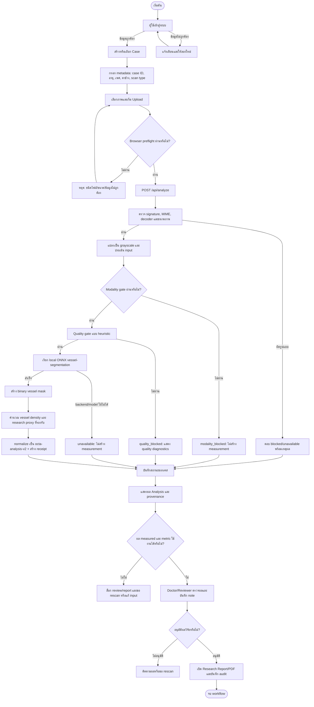
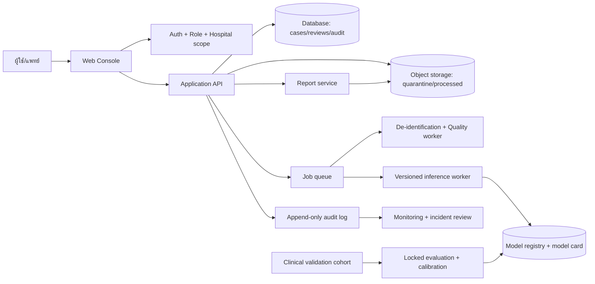

# Thermoeye: Flowchart และเงื่อนไขการทำงาน

เอกสารนี้อธิบายพฤติกรรมของระบบตามโค้ดและสัญญาข้อมูลปัจจุบัน โดยแยกให้ชัดเจนระหว่าง
**สิ่งที่มีอยู่ใน research demo** กับ **สิ่งที่ต้องเพิ่มก่อนใช้งานกับผู้ป่วยจริง**

> **ขอบเขตปัจจุบัน:** Thermoeye รับภาพ OCTA และทำ vessel segmentation เพื่อการวิจัย
> ผลลัพธ์โรค, Alzheimer/MCI risk, risk score และ confidence ยังเป็น `indeterminate`/`N/A`
> เพราะยังไม่มี disease classifier ที่ผ่านการตรวจสอบทางคลินิกเชื่อมต่ออยู่

## 1. Flow หลักของระบบที่มีอยู่

### ลำดับสั้น ๆ สำหรับนำเสนอ

`Login -> Case -> Upload -> ตรวจไฟล์ -> Modality gate -> Quality gate -> Vessel segmentation -> วัดผล -> Doctor review -> Research report`

ทุกผลต้องแสดงสถานะและ provenance เสมอ เพื่อให้ผู้ดูรู้ว่าเป็น measurement จาก engine ใดและผ่าน gate ใดบ้าง

## 2. เงื่อนไขสำคัญของแต่ละจุด

| จุดตรวจ | ผ่านเมื่อ | ไม่ผ่านแล้วเกิดอะไรขึ้น |
| --- | --- | --- |
| Login | credential ของ demo/session ถูกต้อง | เข้า console ไม่ได้และต้องลองใหม่ |
| Case metadata | case ID รูปแบบถูกต้อง, อายุ 0–120, eye/scan type อยู่ในค่าที่รองรับ | ไม่รับเคสหรือคืน `400` |
| File validation | JPEG/PNG/WebP/TIFF, byte signature ตรงกับ MIME, ขนาดและ decoder ใช้ได้ | ปฏิเสธไฟล์หรือแสดง `unavailable` |
| Modality gate | ผ่าน heuristic ของชื่อไฟล์และ preflight; สีอาจผ่านแบบมี warning | `modality_blocked`; ห้ามสร้าง measurement |
| Image quality | quality score ไม่น้อยกว่า 45, contrast ไม่น้อยกว่า 4 และไม่มืดเกินเกณฑ์ | `quality_blocked`; แสดงเหตุผลและแนะนำ rescan |
| Local model | มี ONNX artifact ที่ถูกต้อง และ output เป็น mask ขนาดที่คาดไว้ | `unavailable`; ค่า measurement เป็น `N/A` |
| Measurement | สถานะเป็น `measured` และ engine เป็น local segmentation ที่อนุญาต | ถ้าไม่ใช่ ให้ทุก measurement เป็น `null` |
| Disease result | **ยังไม่มี classifier ที่ validated** | `primaryDisease/riskLevel = indeterminate`, `riskScore/confidence = null` |
| Doctor review | reviewer บันทึก decision และ note | report ยังถูกล็อก |
| Report/PDF | เป็น measured local result, metric ใช้ได้ และ doctor อนุมัติ | preview อาจเห็นได้ แต่ download/release ถูกล็อก |

## 3. ผลลัพธ์ที่ระบบส่งออก

### เมื่อวัดผลสำเร็จ

- `analysisStatus = measured`
- มี `vesselDensity` จาก vessel mask
- มี preview และ segmentation mask ชั่วคราวสำหรับดูใน browser
- มี `modelVersion`, preprocessing, threshold, file hash, timestamp และ `analysisReceipt`
- สถานะโรคยังเป็น **Indeterminate**; ไม่ใช่การวินิจฉัย

### เมื่อ gate หรือ engine ไม่ผ่าน

- `analysisStatus` จะเป็น `modality_blocked`, `quality_blocked` หรือ `unavailable`
- measurement ที่ไม่ปลอดภัยจะเป็น `null` และแสดง `N/A`
- ระบบไม่เติมค่าประมาณเพื่อให้หน้าจอดูสมบูรณ์
- ผู้ใช้ต้องแก้ input, rescan หรือรอให้ backend/model กลับมา

## 4. ภาพรวมส่วนประกอบเมื่อระบบสมบูรณ์ตามเป้าหมาย

ส่วนนี้เป็น **เป้าหมายของระบบ production/pilot** ไม่ใช่สิ่งที่ควรอ้างว่าทำเสร็จแล้วใน demo ปัจจุบัน

## 5. ต้องเพิ่มอะไรจึงจะเรียกว่า “พร้อมใช้งานจริง”

1. **ข้อมูลและสิทธิ์:** dataset/ภาพต้องมีสิทธิ์ใช้ชัดเจน, de-identify, มี label จากผู้เชี่ยวชาญ และแบ่ง train/validation/test ระดับผู้ป่วย
2. **โมเดลโรค:** สร้าง classifier แยกจาก segmentation, กำหนด endpoint ล่วงหน้า, ประเมิน sensitivity/specificity/AUROC/calibration และ subgroup performance
3. **ความทนทานของระบบ:** database จริง, object storage, background workers, retry, backup และ migration
4. **ความปลอดภัย:** authentication จริง, MFA, role/tenant isolation, signed URLs, secret management และ audit ที่แก้ย้อนหลังไม่ได้
5. **การแพทย์และกำกับดูแล:** clinical validation, clinician review protocol, intended-use statement, incident process และการอนุมัติของสถาบัน
6. **รายงาน:** PDF ภาษาไทย/Unicode ที่ตรวจ layout แล้ว และห้าม release ถ้า gate, confidence หรือ review ไม่ครบ
7. **การ deploy:** staging/production config, monitoring, CI, rollback และ runbook สำหรับวันที่นำเสนอหรือใช้งาน pilot

## 6. สิ่งที่ต้องติดตั้งเพิ่มหรือไม่

### สำหรับการอ่าน flowchart

ไม่ต้องติดตั้งอะไรเพิ่ม หากเปิดไฟล์นี้บน GitHub/GitLab ที่รองรับ Mermaid หรือ VS Code ที่มี Markdown Mermaid preview

### สำหรับการรัน demo ปัจจุบัน

ต้องมี:

- Node.js 24 และ dependencies ของ Next.js (`npm install`)
- Python virtual environment ของ backend
- ONNX runtime และ artifact `backend/models/octa/octa_vessel_unet.onnx` หากต้องการวัดผลจริง

ถ้าไม่มี backend/model ระบบยังเปิดหน้าเว็บได้ แต่ผลจะเป็น `unavailable` หรือ `N/A` ตามสัญญาข้อมูล ไม่ใช่ disease prediction

### สำหรับ export เป็นไฟล์แชร์หรือ PDF

ไม่จำเป็นสำหรับการอ่านออนไลน์ หากต้องการส่งเป็น PDF/PNG ให้ใช้ Mermaid CLI หรือ draw.io เพิ่มเป็นเครื่องมือ export เท่านั้น การติดตั้งเครื่องมือ export ไม่ได้ทำให้โมเดลมี clinical validation เพิ่มขึ้น

## 7. ประโยคสรุปสำหรับอธิบายให้คนอื่นฟัง

> Thermoeye รับภาพ OCTA ตรวจความถูกต้องและคุณภาพก่อนใช้โมเดล ONNX แยกเส้นเลือด จากนั้นคำนวณตัวชี้วัดเชิงวิจัยและให้แพทย์ตรวจทานก่อนออก research report ระบบปัจจุบันยังไม่วินิจฉัย Alzheimer หรือโรคอื่น และผลที่ผ่านการ review ไม่ได้แปลว่าได้รับการรับรองทางคลินิก

